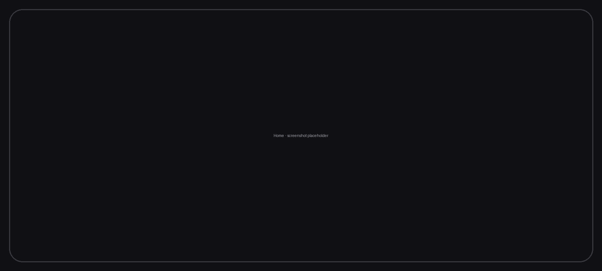

# Soul Launcher

**Minecraft: Java Edition on Android — fast, modern, and now with two engines.**

by 7xPojav_

 

&nbsp;

&nbsp;

&nbsp;

  

&nbsp;

&nbsp;

&nbsp;

  

---

## What is Soul Launcher?

Soul Launcher lets you play **Minecraft: Java Edition** on your Android phone or tablet — every
version from the earliest alphas to the newest **26.x** snapshots, with Forge, Fabric, NeoForge, Quilt,
OptiFine, shaders, resource packs and modpacks from Modrinth and CurseForge.

Version **1.6** is the biggest update so far: a second game engine written in Rust, a built-in friends
system, one-tap multiplayer hosting and voice chat — all inside the launcher you already know.

> You need your own Minecraft: Java Edition account to play online. Soul Launcher is not affiliated
> with Mojang Studios or Microsoft and ships none of their code or assets.

---

[PojavLauncher](https://github.com/PojavLauncherTeam/PojavLauncher) family
([Amethyst](https://github.com/AngelAuraMC/Amethyst-Android)).

Every bundled component, author and license is listed in the app under **About › Legal › Open source
notices**, and in `NOTICE` / `assets/licenses` in this repository. Highlights: OpenJDK (GPL-2.0+CE),
LWJGL (BSD-3), GLFW / SDL3 (zlib), Holy GL4ES, Mesa/Zink (MIT), LTW (LGPL-3), MobileGlues / CSGE (LGPL-2.1),
wgpu, winit, e4mc (MIT/Apache-2.0), authlib-injector (AGPL-3, separate program).

 
Made by 7xPojav_! .

